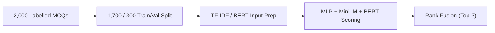
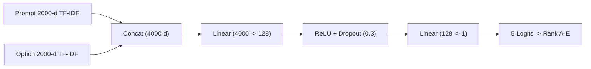

# SMART MCQ SOLVER
### Deep Learning & Generative AI Project Report • BSDA2001P
**Student Name:** Yash Raj | **Roll No.:** 23f2004827  
**GitHub Repository:** [https://github.com/23f2004827/dl-23f2004827-notebook-t22026](https://github.com/23f2004827/dl-23f2004827-notebook-t22026)  
**W&B Project:** `23f2004827-t22026`  

---

| **0.73192** | **0.76262** | **0.9283** |
| :---: | :---: | :---: |
| Kaggle Public MAP@3 • Version 11 | Kaggle Private MAP@3 • Version 11 | Best Validation Ensemble MAP@3 |

---

## 01 Abstract / Executive Summary

The Smart MCQ Solver Challenge requires ranking the three most likely correct answers from five candidate options for each multiple-choice question. The official evaluation metric is Mean Average Precision at 3 (MAP@3), which rewards placing the correct option as high as possible in the ranked list. This project used a progressive modelling strategy:
1. A TF-IDF cosine-similarity baseline
2. A pretrained sentence-transformer (`all-MiniLM-L6-v2`)
3. A fine-tuned BERT multiple-choice model (`bert-base-uncased`)
4. A feedforward neural network trained from scratch on TF-IDF features (`ScratchMCQNet`)

The strongest validation result came from the scratch MLP (MAP@3 0.9122), while fine-tuned BERT achieved 0.8900. A rank-based ensemble of the scratch MLP, MiniLM, and BERT reached 0.9283 on the held-out validation split. The final Kaggle submission used a 0.6 / 0.2 / 0.2 blend of scratch MLP, MiniLM, and BERT and achieved a **public MAP@3 of 0.73192** and **private MAP@3 of 0.76262**, successfully clearing the required 0.73 cutoff. The main finding was that validation performance did not transfer directly to the leaderboard, highlighting overfitting risk and the importance of generalization when selecting ensemble weights.

---

## 02 Introduction

The competition dataset contains 2,000 labelled training questions and 500 test questions. Each question contains a prompt and five candidate answers (A–E), while the training set also provides the correct answer. The task is not simple five-class classification: the submission must return a ranked top-three list, so the position of the correct answer matters.

### Project Objectives
1. Build multiple models with different levels of representation learning.
2. Include both a from-scratch model and pretrained models.
3. Compare experiments using a common validation protocol and Weights & Biases (W&B).
4. Construct an ensemble.
5. Obtain a Kaggle score above the 0.73 project cutoff.

The final solution exceeded that threshold on both the public and private leaderboard scores.

*Figure 1: End-to-end project pipeline used in the final solution.*

---

## 03 Dataset, Preprocessing & Evaluation

The training data has 2,000 rows and eight columns: an ID, the question prompt, five answer options (A–E), and the answer label. The test data has 500 rows and seven columns because the ground-truth answer is unavailable. For the supervised experiments, the training set was split into 1,700 training examples and 300 validation examples using a 15% validation split with `random_state=42`. No data augmentation was used. The baseline and scratch model use TF-IDF representations; the transformer model receives prompt-option text pairs through its tokenizer.

| Dataset / Evaluation Item | Details |
| :--- | :--- |
| **Training set** | 2,000 questions; prompt + five options + answer label |
| **Test set** | 500 questions; prompt + five options |
| **Validation split** | 1,700 train / 300 validation; `test_size=0.15`, `random_state=42` |
| **Prediction format** | Ranked top-3 answer letters from A–E (e.g. `A B C`) |
| **Primary metric** | MAP@3 (Mean Average Precision at 3) |
| **Augmentation** | None |

---

## 04 Tokenization & Representation Strategy

- **TF-IDF Models**: Uses scikit-learn `TfidfVectorizer` with English stop-word removal and a maximum vocabulary of 5,000 features for the cosine-similarity baseline. The scratch MLP uses a 2,000-feature TF-IDF representation. A prompt and each candidate option are represented separately and the resulting vectors are combined by the neural network.
- **Semantic Baseline**: `all-MiniLM-L6-v2` generates contextual sentence embeddings (384-dimensional) and ranks the five options using cosine similarity.
- **BERT Transformer**: `bert-base-uncased` is used with its pretrained tokenizer. Each question is converted into five prompt-option pairs, one for each candidate answer. Tokenization uses truncation, max-length padding, and a maximum sequence length of 256 tokens. This representation lets the multiple-choice head score the five alternatives jointly.

### Evaluation Metric (MAP@3)
MAP@3 rewards a correct answer more when it appears earlier in the three-position ranking:
$$\text{MAP@3} = \frac{1}{|U|} \sum_{u=1}^{|U|} \sum_{k=1}^{\min(3, n)} P(k) \cdot \text{rel}(k)$$
The notebook implements the metric locally as $1/\text{rank}$ when the correct option appears in the top three (1.0 for 1st, 0.5 for 2nd, 0.333 for 3rd) and 0 otherwise, averaged over validation examples. Accuracy and macro F1 are additionally computed from the top-ranked answer.

---

## 05 Representation at a Glance

| Approach | Representation | How candidates are ranked |
| :--- | :--- | :--- |
| **TF-IDF baseline** | 5,000-d TF-IDF | Prompt–option cosine similarity |
| **Scratch MLP** | 2,000-d TF-IDF per text; concatenated to 4,000-d | Five logits; rank highest scores |
| **MiniLM** | 384-d sentence embeddings | Prompt–option cosine similarity |
| **BERT** | Tokenized prompt–option pairs; max length 256 | Multiple-choice head scores five options jointly |

---

## 06 Modeling & Experimentation

### 6.1 TF-IDF Baseline
The baseline represents the prompt and each candidate answer with TF-IDF vectors and ranks candidates by cosine similarity. It uses English stop-word removal and up to 5,000 features. Its MAP@3 on the training data was 0.2762. Because this value is measured on training data, it is treated only as a baseline reference.

### 6.2 Pretrained Sentence-Transformer
The pretrained sentence-transformer `all-MiniLM-L6-v2` is used without fine-tuning. The prompt is embedded once and each candidate option is embedded separately. Cosine similarity between the prompt embedding and each option embedding is used to rank the candidates. On the common validation split, this approach achieved **MAP@3 0.4050**, **accuracy 0.2600**, and **macro F1 0.2578**.

### 6.3 Fine-tuned BERT
The BERT model uses `bert-base-uncased` with `AutoModelForMultipleChoice`. For every question, the same prompt is paired separately with each of the five options. The resulting five sequences are tokenized and passed to the multiple-choice classification head, producing one score per candidate. Trained on Tesla T4 GPU using learning rate 2e-5, batch size 16, fp16 mixed precision, and max_steps=150 (approx. 2.78 passes over training data). Training loss decreased from 3.2122 at step 25 to 1.7558 at step 150. Final validation performance was **MAP@3 0.8900**, **accuracy 0.8200**, and **macro F1 0.8135**.

### 6.4 From-Scratch Feedforward MLP (ScratchMCQNet)
The scratch model is a feedforward network implemented in PyTorch with no pretrained weights:
- Concatenates 2,000-d prompt vector + 2,000-d option vector $\to$ 4,000-d input.
- Layer 1: Linear(4000 $\to$ 128) + ReLU + Dropout($p=0.3$).
- Layer 2: Linear(128 $\to$ 1 logit).
- Five logits form the ranking for a question.
- Trained with cross-entropy loss using Adam (lr=1e-3, weight_decay=1e-4) for 30 epochs.
- Validation score: **MAP@3 0.9122**, **top-1 accuracy 0.8400**, and **macro F1 0.8450**.

*Figure 2: Architecture of ScratchMCQNet implemented from scratch.*

| Model | Key Configuration |
| :--- | :--- |
| **TF-IDF baseline** | `max_features=5000`; English stop-word removal |
| **Scratch MLP** | 30 epochs; `lr=1e-3`; `weight_decay=1e-4`; `hidden_dim=128`; `dropout=0.3` |
| **MiniLM** | Frozen encoder; no fine-tuning; 384-d embeddings |
| **Fine-tuned BERT** | 1 epoch / `max_steps=150`; `lr=2e-5`; `batch_size=16`; `max_length=256`; fp16 |

---

## 07 Training Performance & Comparative Evaluation

The three principal models were evaluated on the same 300-example validation split. Their final W&B comparison runs log MAP@3, top-1 accuracy, and macro F1:

| Model | MAP@3 | Accuracy | Macro F1 |
| :--- | :---: | :---: | :---: |
| **MiniLM (frozen)** | 0.4050 | 0.2600 | 0.2578 |
| **BERT (fine-tuned)** | 0.8900 | 0.8200 | 0.8135 |
| **Scratch MLP** | **0.9122** | **0.8400** | **0.8450** |

**Comparative insight:** The scratch MLP was the strongest individual model on the common validation split, while fine-tuned BERT was the strongest pretrained model. MiniLM's frozen representation was substantially weaker, confirming the value of task-specific fine-tuning for this MCQ-ranking objective.

---

## 08 Ensembling & Kaggle Performance

The final rank-fusion method assigns a score to each answer option according to its position in each model's top-three ranking. Grid search over weights in increments of 0.1 on the validation set selected:
- **Best Validation Blend**: Scratch MLP = 0.5, MiniLM = 0.1, BERT = 0.4 $\to$ **Validation MAP@3 = 0.9283**.
- **Final Kaggle Submission (Version 11)**: Scratch MLP = 0.6, MiniLM = 0.2, BERT = 0.2 $\to$ **Public MAP@3 = 0.73192**, **Private MAP@3 = 0.76262**.

| Experiment | Weights / Method | Validation MAP@3 | Decision |
| :--- | :--- | :---: | :--- |
| **Rank fusion** | Scratch 0.5 / MiniLM 0.1 / BERT 0.4 | **0.9283** | Best validation blend |
| **Probability fusion** | TF-IDF 0.0 / MiniLM 0.2 / BERT 0.8 | 0.8933 | Rejected |
| **Final Kaggle submission** | Scratch 0.6 / MiniLM 0.2 / BERT 0.2 | — | Submitted as Version 11 |

| **0.73192** | **0.76262** | **$\ge$ 0.73** |
| :---: | :---: | :---: |
| Public Kaggle MAP@3 | Private Kaggle MAP@3 | Required Cutoff |

---

## 09 Additional Experiments

1. **Probability-weighted ensemble**: Combined softmax-normalized TF-IDF, MiniLM, and BERT scores. Best validation MAP@3 was 0.8933, lower than rank-based ensemble, so it was not selected.
2. **DeBERTa-v3-small**: Fine-tuned as an alternative transformer. Validation MAP@3 was 0.3589 under the experiment's training setup, retained as a negative experimental result.
3. **Zero-shot Qwen2.5-7B**: Explored in 4-bit quantization using answer-letter logits extracted directly from the prompt output distribution.

---

## 10 Interpretation

The best validation ensemble (0.9283) should not be confused with the final Kaggle submission score. The former was selected by grid search on the 300-example validation set; the latter is the 0.6/0.2/0.2 configuration explicitly saved in the notebook as the final submission and is the configuration associated with the reported Version 11 score.

**Outcome**: Both public (0.73192) and private (0.76262) leaderboard scores exceeded the required 0.73 cutoff.

---

## 11 Error Analysis

The central error-analysis finding is the **gap between very high validation performance (0.9283) and leaderboard performance (0.73192 / 0.76262)**:
- The scratch MLP can fit lexical patterns in the relatively small training set (1,700 rows).
- The validation set contains only 300 examples, so optimizing ensemble weights against it produces an optimistic estimate.
- Pretrained BERT generalized much more reliably than lexical models because it relies on deep contextual language representations rather than exact keyword overlap.

---

## 12 Conclusion & Future Work

The project demonstrates a complete MCQ-ranking workflow from lexical baselines to semantic embeddings, transformer fine-tuning, neural networks from scratch, and ensemble learning.

### Key Takeaways & Future Directions
- **K-fold cross-validation** for ensemble weight selection to reduce validation set overfitting.
- **Extended fine-tuning** of BERT / DeBERTa with learning rate schedules and gradient accumulation.
- **Retrieval-Augmented Generation (RAG)** to inject external domain knowledge for complex reasoning prompts.

---

## 13 Deployment & Reproducibility

- **Hugging Face Space**: [https://huggingface.co/spaces/Yash-Raj-1812/DL-23f2004827-mcq-solver](https://huggingface.co/spaces/Yash-Raj-1812/DL-23f2004827-mcq-solver)  
- **Streamlit Cloud App**: [https://appappppy-6ezt6h6twvolnaxei5yjef.streamlit.app](https://appappppy-6ezt6h6twvolnaxei5yjef.streamlit.app)  
- **Alternative Space**: [https://huggingface.co/spaces/Yash-Raj-1812/mcq-solver-app](https://huggingface.co/spaces/Yash-Raj-1812/mcq-solver-app)  
- **W&B Project**: [https://wandb.ai/23f2004827-t22026](https://wandb.ai/23f2004827-t22026)  
- **GitHub Repository**: [https://github.com/23f2004827/dl-23f2004827-notebook-t22026](https://github.com/23f2004827/dl-23f2004827-notebook-t22026)  

---

## 14 References

1. Devlin, J., Chang, M.-W., Lee, K., & Toutanova, I. (2019). *BERT: Pre-training of Deep Bidirectional Transformers for Language Understanding*. NAACL-HLT.
2. Reimers, N., & Gurevych, I. (2019). *Sentence-BERT: Sentence Embeddings using Siamese BERT-Networks*. EMNLP.
3. Pedregosa, F. et al. (2011). *Scikit-learn: Machine Learning in Python*. JMLR, 12, 2825–2830.
4. Paszke, A. et al. (2019). *PyTorch: An Imperative Style, High-Performance Deep Learning Library*. NeurIPS.
5. Hugging Face Transformers: `AutoModelForMultipleChoice` & `Trainer` APIs.
6. Weights & Biases: Experiment tracking and metrics comparison under project `23f2004827-t22026`.
